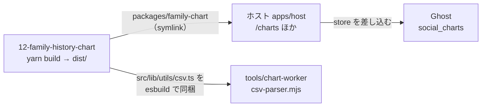

# family-history-chart（`@ghost-next/family-chart`）

家系図・年表・関係図をブラウザで描いて編集する React のライブラリ（D3 + TypeScript、Vite でビルド）。
フロント（`01-ghost-front`）が `packages/family-chart` へのリンクとして取り込み、ホストの `/charts` 画面などで使う。

## この文書の内容

| 節 | 内容 |
|---|---|
| [役割と位置](#役割と位置) | ホスト・Ghost・chart ジョブとの関係 |
| [できること](#できること) | レイアウト・関係の種類・入出力 |
| [中の構成](#中の構成) | 主なフォルダ |
| [公開している API](#公開している-api) | export・`DataProvider`・`FamilyChartEditor`・`FamilyChartList` の props |
| [開発の手順](#開発の手順) | 入れる・単体で動かす・ビルド |
| [ホストでの使われ方](#ホストでの使われ方) | どの画面がどう使うか、保存先 |
| [注意](#注意) | 壊しやすい所 |
| [ブランチ](#ブランチ) | `main` と作業ブランチ |
| [詳しい文書](#詳しい文書) | このリポジトリの docs と、01-ghost-front の docs |

## 役割と位置



- ホストはこのリポジトリの**ビルド済み `dist`** を読む（`package.json` の `exports` が `dist` を指す）。ソースは読まない。
- 保存先は差し替えられる。単体では REST（json-server）に保存し、ホストでは Ghost の `social_charts` に保存する。

## できること

- レイアウト: `auto`・`tidy`（系図）・`timeline`（年表）・`force`（関係図）。`ViewSettings.layoutMode` にチャートごとに保存する。
- 関係の種類（`RelationType`）: `parent-child`・`marriage`・`remarriage`・`partner`・`sibling`・`succession`・`ally`・`rival`・
  `mentor`・`enemy`・`friend`・`master`・`disciple`・`comrade`・`liege`・`custom`。
- キャンバスで編集する（ドラッグ・ダブルクリックで追加/名前変更など）。操作の一覧は [docs/shortcuts.md](docs/shortcuts.md)。
- メモ（注記ノード）・手描き（undo/redo あり）・縦書き（`off` / `cjk` / `on`）。
- CSV の取り込み・書き出し（`src/lib/utils/csv.ts`）。取り込みは今の図に追記する。
- サムネイル: 見えている範囲を PNG にして `uploadThumbnail` に渡す。
- 文言は `t`（翻訳関数）で引く。ホストが渡さないときはキー（か fallback）がそのまま出る。

## 中の構成

| 場所 | 中身 |
|---|---|
| `src/lib/index.ts` | ライブラリの入口（export の一覧） |
| `src/lib/app/` | `FamilyChartEditor`・`FamilyChartList`・設定ダイアログ |
| `src/lib/components/canvas/` | D3 のキャンバス `DynastyNetwork`・`NodeCard`・図形 |
| `src/lib/components/editors/` | 人物・関係の編集パネル |
| `src/lib/context/DataContext.tsx` | `DataProvider` と `useDataContext`（状態と保存） |
| `src/lib/services/layoutStore.ts` | 単体用の REST の保存（`createLayoutStore`） |
| `src/lib/types/charts.ts` | データの型（`PageProps`・`PersonNode`・`Relationship` など） |
| `src/lib/utils/csv.ts` | CSV ⇔ グラフの変換。chart-worker もこれを使う |
| `src/demo/` | 単体で動かすデモ（react-router。`/charts`・`/edit/:id`） |
| `data/db.json` | デモ用の json-server のデータ |
| `docs/` | 形式の説明・サンプル CSV（`docs/samples/`）・設計メモ |

## 公開している API

`src/lib/index.ts` が export するもの:

| 名前 | 種類 | 用途 |
|---|---|---|
| `DataProvider` / `useDataContext` | 部品 / hook | 状態と保存の土台。中の部品はこの下に置く |
| `FamilyChartEditor` | 部品 | 1 つのチャートの編集・表示 |
| `FamilyChartList` | 部品 | チャートの一覧 |
| `DynastyNetwork`・`NodeCard`・`EdgeCard`・`RelationshipTypeDialog` | 部品 | 中の部品 |
| `PageProps`・`ChartProps`・`PersonNode`・`Relationship`・`NodeShape`・`FamilyChartEditorProps`・`FamilyChartListProps` | 型 | |

スタイルは `import '@ghost-next/family-chart/style.css'`（`./styles` も同じ `dist/family-chart.css`）。

### `DataProvider` の props

| prop | 既定 | 説明 |
|---|---|---|
| `apiBaseUrl` | `/api/charts` | 単体用 REST の起点。`store` を渡したときは使わない |
| `store` | `createLayoutStore(apiBaseUrl)` | 保存先。`getPageList`・`getPageById`・`savePage`・`insertPage`・`updatePage`・`deletePage` を持つもの |
| `uploadFile` | なし | `(file: File) => Promise<string>`。画像・動画を上げて URL を返す |
| `uploadThumbnail` | なし | `(chartId, blob) => Promise<string>`。サムネイルを上げて URL を返す |
| `thumbnailDpi` | `150` | サムネイル（A4 横）の DPI |
| `t` | キーか fallback を返す | `(key, fallback?) => string` |
| `locale` | `'ja'` | |

型 `LayoutStore` と `TranslateFn` は `index.ts` から export していない（ホストは `store as any` で渡している）。

### `FamilyChartEditor` の props

| prop | 説明 |
|---|---|
| `id` | 開くチャートの id |
| `mode` | `'edit'` か `'view'`。`'view'` 以外（省略を含む）は編集できる |
| `onBack` | 一覧へ戻る |
| `onOpenView` / `onOpenEdit` | `(id) => void`。表示 / 編集へ移る |

### `FamilyChartList` の props

| prop | 説明 |
|---|---|
| `onOpen` / `onView` | `(id) => void`。編集 / 表示を開く |
| `canChangeAuthor` | 既定 `false`。true で作者を変える欄を出す（Owner/Admin 向け） |
| `getUsers` | 作者の候補を返す。`canChangeAuthor` のとき要る |
| `getGroups` | 共有先のグループ・家族を返す |

## 開発の手順

```bash
cd ~/work/legacy/12-family-history-chart
yarn install
yarn dev          # vite（:5173）と json-server（:3195、data/db.json）を一緒に起動。/api は :3195 へ proxy
yarn build        # ライブラリのビルド → dist/（ホストが読むのはこれ）
yarn build:demo   # デモのビルド → dist-demo/
yarn preview      # ビルドしたものを vite preview で見る
```

- `yarn build` の出力: `dist/dynasty-history-chart.es.js`・`dist/dynasty-history-chart.umd.js`・`dist/index.d.ts`・`dist/family-chart.css`。
  `react`・`react-dom`・`d3` は同梱しない（external）。
- テストは無い。動きはデモか、ホストの `/charts` で確かめる。
- `yarn lint` は `eslint src` だが、eslint は devDependencies に無く、設定ファイルも無い。

## ホストでの使われ方

ホスト（`01-ghost-front/apps/host`）は `package.json` で `"@ghost-next/family-chart": "*"` とし、workspace のリンクで読む。

| ホストの場所 | 使う部品 | 保存先など |
|---|---|---|
| `src/app/charts/page.tsx` | `FamilyChartList` | `createSocialChartsStore()`（Ghost の `social_charts`）。`getUsers`・`getGroups` を渡す |
| `src/app/charts/edit/[id]/page.tsx` | `FamilyChartEditor`（`edit`） | 同上。`uploadFile`・`uploadThumbnail`（`chartThumbnailUpload.ts`）・`thumbnailDpi`（`NEXT_PUBLIC_CHART_THUMBNAIL_DPI`） |
| `src/app/charts/view/[id]/page.tsx` | `FamilyChartEditor`（`view`） | 同上 |
| `src/app/charts-public/view/[id]/page.tsx` | `FamilyChartEditor`（`view`） | `createPublicSocialChartsStore()` |
| `src/templates/stackpage/ChartViewer.tsx` | `FamilyChartEditor`（`view`） | stackpage のページに埋め込む |

`t` と `locale` はホストの `useTranslation()` から渡す。文言の訳は 01-ghost-front の `packages/i18n/locales/*/front.json` にある。

chart ジョブ（01-ghost-front の `tools/chart-worker`）は、このリポジトリの `src/lib/utils/csv.ts` を esbuild でまとめた
`tools/chart-worker/src/csv-parser.mjs` を使う（`yarn workspace chart-worker gen:csv-parser` で作り直す）。
CSV の列は [docs/csv-format.md](docs/csv-format.md) が正。01-ghost-front の skill `.claude/skills/chart-csv-format` はその要約。

## 注意

- **変えたら `yarn build` し直す**。ホストは `dist` を読み、watch は無い。`dist` は git に入っていない。
- **`csv.ts` を変えたら chart-worker の `csv-parser.mjs` も作り直してコミットする**（01-ghost-front 側の作業）。忘れるとジョブとブラウザで CSV の解釈がずれる。
- CSV の列を変えたら `docs/csv-format.md` と skill `chart-csv-format` もそろえる。
- 配布のビルドは手元の作業フォルダをそのまま取り込む。配布の前に `main` にそろえてビルドし直す（[08-deploy](https://github.com/aidabo/jibunsee-react/blob/main/docs/development/08-deploy.md)）。

## ブランチ

- 既定のブランチは `main`。
- `vite-conversion-editor` という作業ブランチがある。PR #4 で `main` にマージ済み（2026-10-30 時点で `main` に無いコミットは無い）。

## 詳しい文書

このリポジトリ:

- [docs/csv-format.md](docs/csv-format.md) — CSV の列と書き方
- [docs/chart-json-format.md](docs/chart-json-format.md) — チャートの JSON の形
- [docs/import-schema.md](docs/import-schema.md) — 取り込みの規則
- [docs/shortcuts.md](docs/shortcuts.md) — 操作とショートカット
- [docs/samples/](docs/samples/) — サンプル CSV と生成スクリプト
- `docs/` のほかの文書（`host-merge-plan.md`・`chart-job-agent-plan.md` など）は計画・設計時のメモ。今の動きはコードで確かめる

01-ghost-front（jibunsee-react）:

- [01-workspace](https://github.com/aidabo/jibunsee-react/blob/main/docs/development/01-workspace.md) — clone とリンク
- [04-frontend](https://github.com/aidabo/jibunsee-react/blob/main/docs/development/04-frontend.md) — ホストの起動とライブラリのビルド
- [05-runner](https://github.com/aidabo/jibunsee-react/blob/main/docs/development/05-runner.md) — chart ジョブの worker
- [06-business-libs-estate](https://github.com/aidabo/jibunsee-react/blob/main/docs/development/06-business-libs-estate.md) — ライブラリとホストの関係
- [chart-viewsettings-persistence](https://github.com/aidabo/jibunsee-react/blob/main/docs/architecture/chart-viewsettings-persistence.md) — 表示設定の保存

## ライセンス

LICENSE ファイルは無い。社内用で、外部での利用は許諾していない。
